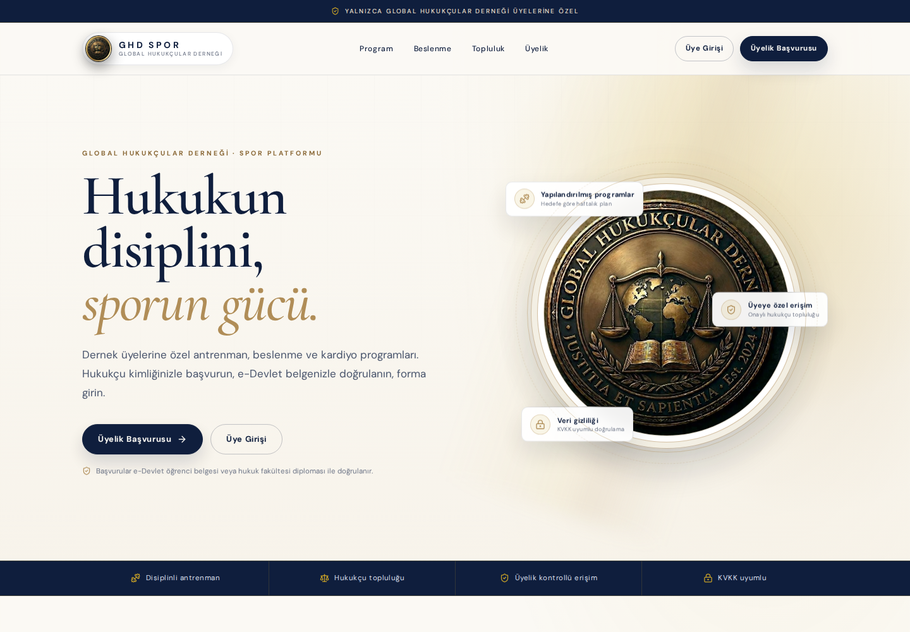
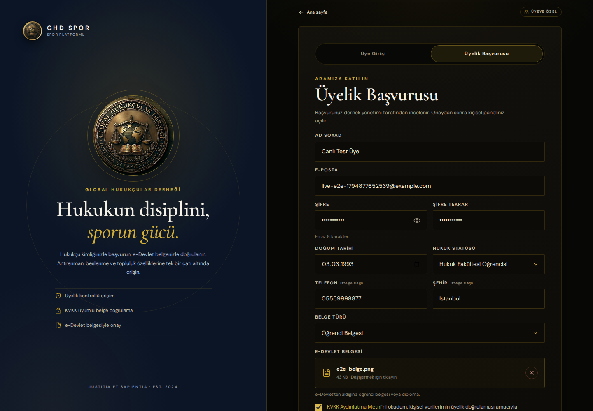
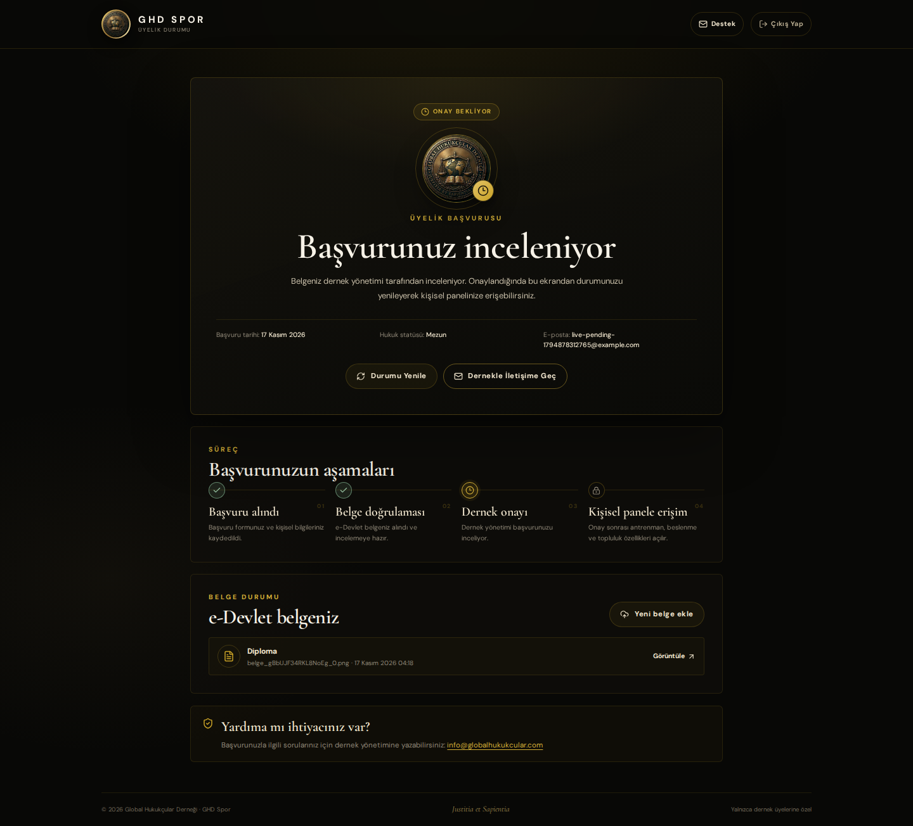
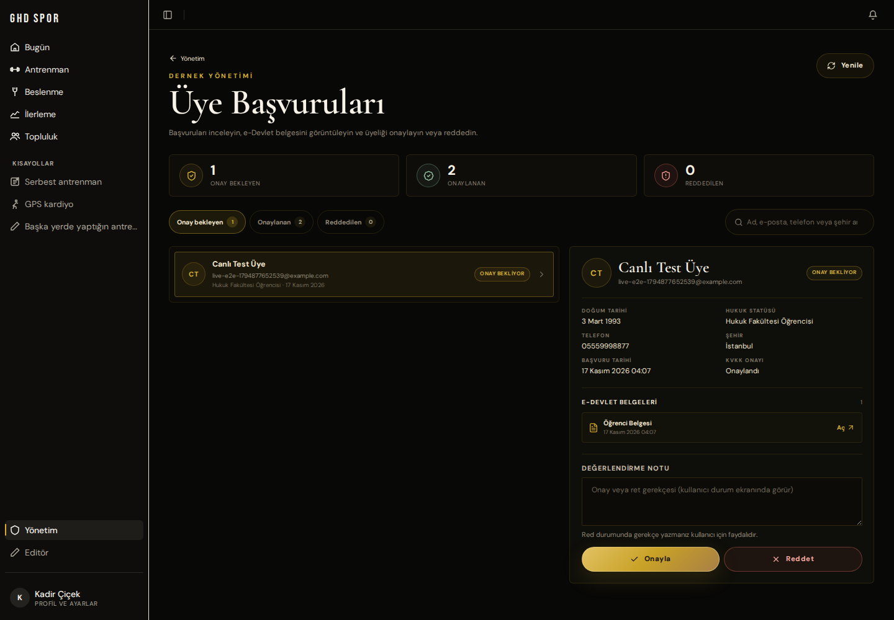
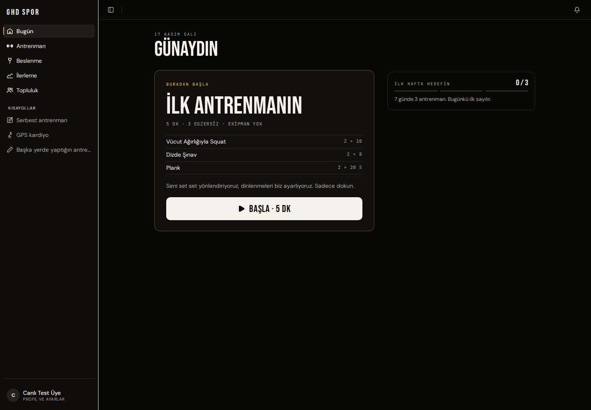
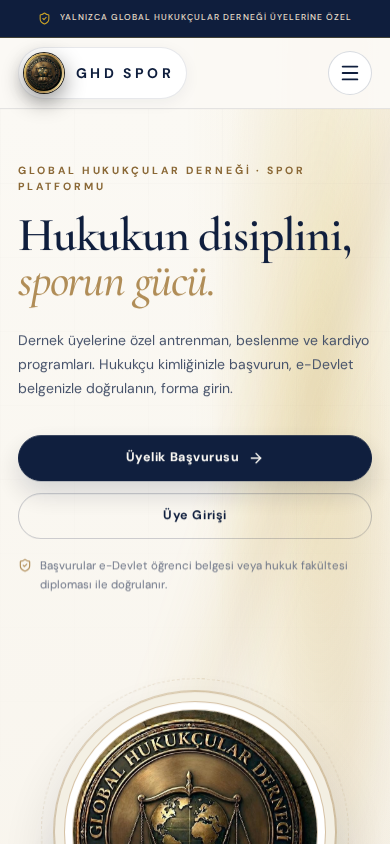

# GHD Spor — Global Hukukçular Derneği Spor Platformu

> **Hukukun disiplini, sporun gücü.**
> Yalnızca Global Hukukçular Derneği üyelerine özel antrenman, beslenme ve kardiyo platformu.

[](https://spor.globalhukukcular.com)
[](https://pocketbase.io)
[](LICENSE.md)

## Canlı

**https://spor.globalhukukcular.com**

## Nedir?

GHD Spor, Global Hukukçular Derneği üyelerinin kullanabileceği; yapılandırılmış antrenman programları, beslenme takibi, kardiyo/GPS kaydı, ilerleme analizi ve topluluk özelliklerini tek panelde birleştiren bir spor platformudur.

Platform erişimi **dernek üyeliği onayına** bağlıdır. Başvuruda:

- **Doğum tarihi** (zorunlu)
- **Hukuk fakültesi öğrencisi / mezunu** bilgisi (zorunlu)
- **e-Devlet belgesi**: öğrenci belgesi veya hukuk fakültesi diploması (PDF/JPG/PNG, en fazla 10 MB)
- KVKK onayı

alınır. Dernek yönetimi belgeyi inceledikten sonra hesap `approved` durumuna geçer; onaylanana kadar uygulama verileri hem arayüzde hem API katmanında kapalıdır.

## Özellikler

- 🏋️ Yapılandırılmış kalistenik ve kuvvet programları
- 🥗 Kalori/makro takibi ve öğün kaydı
- 🏃 GPS'li kardiyo seansları
- 📈 İlerleme, seri ve rozetler
- 👥 Üyeye özel topluluk, arkadaşlar ve liderlik tablosu
- 🔐 Üyelik doğrulamalı erişim, KVKK odaklı belge saklama
- 📱 PWA + Android (mevcut altyapı)

## Mimari

| Katman | Teknoloji |
|---|---|
| Web | React, Vite, Tailwind CSS, shadcn/ui, PWA |
| Backend | PocketBase 0.36 (SQLite, migration + JS hook) |
| Ortak | pnpm monorepo, `packages/core` |
| Deploy | Docker (tek container), Caddy reverse proxy, otomatik TLS |
| Test | Playwright, Vitest |

```
apps/web            → React/Vite arayüzü
packages/core       → ortak tipler, hook'lar, i18n
pb_migrations       → veritabanı şeması + üyelik sistemi
pb_hooks            → API erişim kilidi, onay kuralları
deploy/             → Docker Compose + Caddy örneği
```

## Üyelik Akışı

1. **Başvuru** — `/auth?mode=signup`: kimlik, doğum tarihi, hukuk statüsü, e-Devlet belgesi, KVKK onayı.
2. **Bekleme** — Hesap `pending`; uygulama rotaları ve API erişimi kapalı.
3. **İnceleme** — Dernek admin'i `/admin/uyeler` ekranından belgeyi açar, onaylar/reddeder.
4. **Erişim** — `approved` kullanıcı dashboard'a girer.

Sunucu tarafında:
- `users.membership_status` kullanıcı tarafından değiştirilemez.
- Belgesiz başvuru onaylanamaz.
- `membership.pb.js` middleware'i onaysız kullanıcıların uygulama API'lerini 403 ile engeller.
- e-Devlet belgeleri ayrı `membership_documents` koleksiyonunda; yalnızca sahibi ve admin erişir.

## Gizlilik Notu

Bu fork'ta upstream projedeki gömülü Sentry DSN'i ve OpenPanel analitik uç noktası **kaldırılmıştır**. Hata izleme/analitik yalnızca deploy sırasında `VITE_SENTRY_DSN` / `VITE_OPENPANEL_API_URL` + `VITE_OPENPANEL_CLIENT_ID` verilirse ve kendi hesabınıza bağlanırsa çalışır; varsayılan olarak hiçbir üye verisi üçüncü tarafa gitmez. `sendDefaultPii` kapalıdır.

## Yerel Geliştirme

```bash
pnpm install
cp .env.example .env.local   # gerekli alanları doldur
pnpm dev                     # Vite
pnpm pb:serve                # PocketBase (ayrı terminal)
```

PocketBase admin: `http://127.0.0.1:8090/_/`

## Üretim Deploy

```bash
docker compose -f deploy/docker-compose.yml up -d --build
docker exec sporgla-app ./pocketbase superuser upsert <email> <strong-password> --dir=/app/pb_data
```

Caddy için `deploy/Caddyfile.snippet` bloğunu mevcut Caddyfile'a ekleyin. Ayrıntı: [`deploy/README.md`](deploy/README.md).

Dernek yöneticileri için üyelik onay akışı: [`docs/ADMIN.md`](docs/ADMIN.md). Test ve kabul kanıtları: [`TESTING.md`](TESTING.md).

## Ekran Görüntüleri

| Landing (masaüstü) | Üyelik başvurusu |
|---|---|
|  |  |

| Onay bekleyen üye | Admin üye onayı |
|---|---|
|  |  |

| Üye paneli | Landing (mobil) |
|---|---|
|  |  |

## Bilinen Sınırlar

- AI koç API'si bu kurulumda kapalıdır (`VITE_AI_API_URL` boş); temel antrenman/beslenme/kardiyo akışları çalışır.
- Onay/red e-postası gönderimi yapılandırılmamıştır; üye durumunu **Durumu Yenile** ile görür.
- Antrenman kataloğu upstream çok dilli veriden gelir; Türkçe karşılığı olmayan katalog içeriğinde İngilizce ad gösterilir. Arayüz, varsayılan ilk antrenman ve üyelik akışı Türkçedir.
- Dernek yöneticisi hesapları bootstrap sırasında belgesiz `approved` oluşturulur; normal üyeler için e-Devlet belgesi zorunludur.

## Açık Kaynak Atıf

Bu proje [guillermoscript/calistenia-app](https://github.com/guillermoscript/calistenia-app) açık kaynak projesinden (MIT) uyarlanmıştır. Özgün mimari ve bileşenler için upstream projeye teşekkürler. Marka, üyelik sistemi ve Türkçe arayüz Global Hukukçular Derneği için özelleştirilmiştir.

## Lisans

MIT — ayrıntılar için [LICENSE.md](LICENSE.md).
